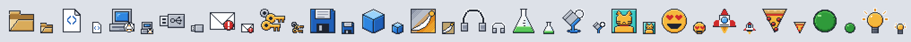
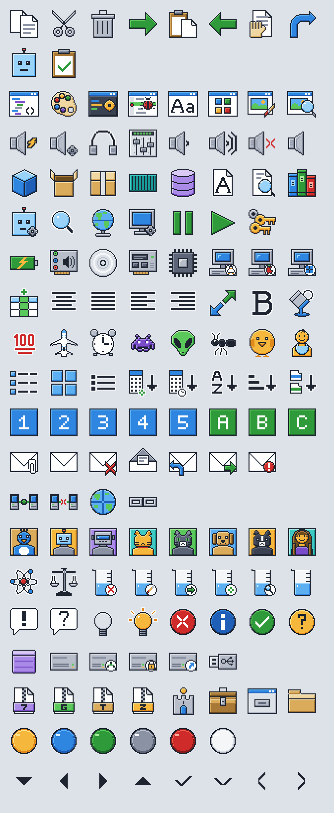

# Nucleus Icons



This is a pixel exact icon suite for Bastion Nucleus, an agentic operating system.
The icons are drawn as SVG on a strict pixel grid in the spirit of the Win9x era,
coloured with a Frutiger leaning palette. The final artefact is a 256 colour PNG
atlas which is used by the Nucleus desktop experience, but can be used for your
own projects too.

## Building the icon pack

Running the build compiles every icon into a release in `dist/`:

| File | Contents |
| ---- | -------- |
| `nucleus-icons-16.png` | Indexed PNG atlas of every icon at 16 x 16 |
| `nucleus-icons-32.png` | Indexed PNG atlas of every icon at 32 x 32 |
| `nucleus-icons.json` | Manifest including palette, page sizes and the cell positions |
| `LICENSE` | The licence for the artwork and tooling |

Both PNG pages use an 8 bit palette with index 0 transparent and every other
entry an opaque colour from `src/palette.json`. The icons are laid out on a grid of
16 columns in alphabetical order of `domain/name`.

The manifest looks like this:

```json
{
  "name": "nucleus-icons",
  "version": "0.1.0",
  "palette": ["transparent", "#1e2430", "..."],
  "pages": {
    "16": { "file": "nucleus-icons-16.png", "cell": 16, "columns": 16, "width": 256, "height": 16 },
    "32": { "file": "nucleus-icons-32.png", "cell": 32, "columns": 16, "width": 512, "height": 32 }
  },
  "icons": {
    "system/folder": { "domain": "system", "name": "folder", "16": { "x": 0, "y": 0 }, "32": { "x": 0, "y": 0 } }
  }
}
```

To draw an icon, you can look up its id/page, and copy the `cell` sized square
at `x, y` from that page.

## Version 0.1

Version 0.1 is the first corpus for Bastion Nucleus. It covers the shell,
hardware, storage, mail, editor toolbars, a science set, a full emoji set on a
yellow basis, avatar portraits, and black stencil glyphs for window chrome.
Every icon has a 16 and 32 pixel variant on the shared palette with a one pixel
bevel described in [style.md](style.md).

<!-- contents:start -->
508 icons across 20 domains, each at 16 and 32 pixels.

| Domain | Icons | Covers |
| ------ | ----- | ------ |
| actions | 10 | Commands: save, delete, cut, copy, paste, undo, redo, next, previous |
| agents | 2 | Agents, tasks, plans, tools an agent may hold |
| apps | 14 | Bundled applications: system monitor, notepad, colour picker, theme |
| audio | 11 | Speakers, volume states, mixer |
| components | 12 | Building blocks: databases, tensors, 3d assets, packages, containers, services |
| control | 7 | Control panel applets: globe, security, graphics, agent |
| devices | 21 | Hardware: display, disk, ports, network adapter, mouse, power |
| editor | 35 | Toolbar glyphs: text formatting, alignment, lists, charts, drawing tools |
| emoji | 243 | Faces, hearts, hands, creatures and objects on a yellow basis |
| filemanager | 8 | Explorer view modes and sort orders |
| labels | 10 | Numbered and lettered boxes for ordering and keyed lists |
| mail | 7 | Envelopes and mail actions: closed, send, reply, delete |
| network | 4 | Connectivity, globe, links, hosts, transfer |
| profile | 19 | Generic avatar portraits to pick from: people, bots, pets, system |
| science | 37 | Lab glassware, instruments, maths glyphs and data actions |
| status | 9 | Small state glyphs: ok, warning, error, info, busy |
| storage | 6 | Drives, databases, volumes, snapshots |
| system | 22 | Shell objects: folders, pages, archives, scripts, executables, terminals |
| traffic | 6 | Round indicator lights in each colour |
| ui | 25 | Black stencil glyphs for window chrome and controls |
<!-- contents:end -->

The table is generated from the sources by `npm run contents`.



## Why it exists

Bastion Nucleus needs a consistent visual language across its shell, agent
tooling and status surfaces. Rendering the icons from a fixed palette atlas
keeps them crisp at native sizes, cheap to load and identical on every
platform. The SVG sources are supposed to remin easy to edit and review.

## Repository layout

```
src/
  palette.json          the colour palette, the single source of truth
  icons/<domain>/       SVG sources, one <name>.16.svg and <name>.32.svg per icon
scripts/
  build.js              compiles dist/ from the sources
  lib/palette.js        palette lookup and quantisation, shared with Storybook
  lib/png.js            indexed PNG encoder
  contents.js           refreshes the domain table in this readme
  showcase.js           renders the sampler images in docs/
tools/                  pixel generators that draw the SVG sources, one file per group
docs/                   sampler images for this readme, made by scripts/showcase.js
stories/                Storybook, one stories file per domain
.storybook/             Storybook configuration
style.md                the design system
dist/                   build output, not committed
```

## Working on the set

Install dependencies once:

```bash
npm install
```

Build the atlas release:

```bash
npm run build
```

Validate the sources without writing anything:

```bash
npm run check
```

Open Storybook to browse every domain at 4x on light, dark and checker
backgrounds. The build runs first so the compiled atlas can be previewed under
Release:

```bash
npm run storybook
```

Icons are drawn with the generators in `tools/`. Each file describes its icons
as layers of pixel rectangles on top of the shared helpers in `tools/lib.mjs`,
which derives the bevels and writes one SVG path per colour. The SVG files in
`src/icons` remain the source the build reads.

Redraw every icon, or only the named generator files:

```bash
npm run draw
```

```bash
npm run draw -- devices emoji-food
```

Render a review sheet of chosen icons at 6x on light and dark:

```bash
npm run preview -- review.png devices/cpu emoji/cat
```

To add an icon, add it to the matching generator (or a new one) following
[style.md](style.md), run the draw script, then run the check. To add a domain,
create its folder and copy one of the three line files in `stories/`.

## Code style

The scripts and stories are plain ES modules with no build step of their own.
Comments are short and only where the code does not explain itself. Code and
prose avoid semicolons and em dashes, so loops iterate with for of and
sentences take a full stop instead.

## Releases

Every push runs the GitHub Actions workflow in `.github/workflows/build.yml`,
which validates the sources, compiles the atlas, builds Storybook and uploads
the release zip as a workflow artefact. Pushing a tag of the form
`v<major>.<minor>.<patch>` also publishes a GitHub release with
`nucleus-icons-v<version>.zip` attached, holding the two atlas pages, the
manifest and the licence.

To cut a release, bump the version in `package.json` so the manifest carries
it, refresh the readme images and table, commit, then tag and push:

```bash
npm run contents && npm run showcase
```

```bash
git tag v0.1.0 && git push origin main --tags
```

## AI disclosure

This icon set and its tooling were produced with the assistance of AI tools
(Claude by Anthropic). The design direction, review and acceptance of every
icon are human decisions, but the artwork and code should be understood as AI
assisted work.

## Licence

Icon artwork is licensed under CC BY 4.0. The build tooling and Storybook code
are licensed under MIT. See [LICENSE](LICENSE) for both.

Feel free to use this in your own projects if you find this useful.
